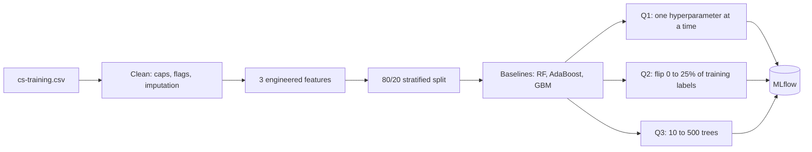
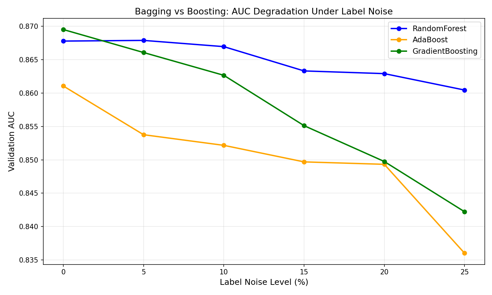
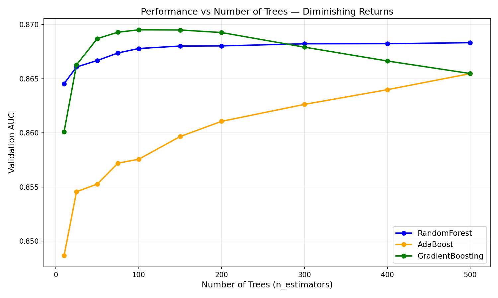

# Loan Default Prediction with Ensemble Methods

A study of Random Forest, AdaBoost and Gradient Boosting on 150,000 real borrowers. Instead of only chasing the best score, it answers three practical questions with controlled experiments: which hyperparameter matters most for each method, which method survives noisy labels, and when adding more trees stops helping.

## Results

| Question | Answer |
|---|---|
| Best model on clean data | Gradient Boosting, **0.8695** AUC |
| Most important hyperparameter | Tree depth for Random Forest. Learning rate for both boosting methods, where a bad value drops AUC to 0.50 |
| Most robust to label noise | Random Forest lost only **0.0073** AUC at 25% noise, **3.5x** less than boosting |
| Right number of trees | About 100. Gradient Boosting gets worse after 150 |

## Dataset

[Give Me Some Credit](https://www.kaggle.com/c/GiveMeSomeCredit/data) from Kaggle: 150,000 borrowers, 10 features, and a target of whether the borrower fell 90 or more days behind within 2 years. Only 6.7% did, so every model is scored on ROC-AUC rather than accuracy.

## How it works



### Cleaning

| Problem | Fix |
|---|---|
| One borrower with age 0 | Dropped |
| Credit utilization up to 50,708 and debt ratio up to 329,664 | Capped at the 99th percentile |
| Codes 96 and 98 in all three late payment columns | Flagged as a data error and replaced with the clean median |
| Monthly income missing for 19.8% | Flagged, filled and capped |
| Number of dependents missing for 2.6% | Filled with the median |

The 96 and 98 values always showed up on the same 269 rows across all three late payment columns. That pattern showed they were system error codes, not real counts.

### Features

* **TotalTimesLate:** the three late payment counts added together
* **IncomePerDependent:** monthly income divided by dependents plus one, a ratio trees cannot build on their own
* **TotalCreditLines:** open credit lines plus real estate loans

### Baselines with default settings

| Model | AUC |
|---|---|
| Random Forest | 0.8435 |
| AdaBoost | 0.8497 |
| **Gradient Boosting** | **0.8689** |

## Q1: Which hyperparameter matters most?

I changed one hyperparameter at a time and measured the AUC swing between its best and worst value.

| Method | Most important | AUC swing | Next most important |
|---|---|---|---|
| Random Forest | max_depth | 0.024 | min_samples_leaf, 0.023 |
| AdaBoost | learning_rate | **0.355** | n_estimators, 0.016 |
| Gradient Boosting | learning_rate | **0.275** | max_depth, 0.011 |

* For Random Forest, unlimited depth scored 0.8435 but depth 10 scored 0.8679. Deep trees memorized noise.
* For AdaBoost, a learning rate of 2.0 collapsed AUC to 0.50, no better than guessing. At 0.01 it reached only 0.70 because it never finished learning.
* Bagging is controlled by how complex each tree is. Boosting is controlled by how hard each round corrects the last one.

## Q2: Which method handles noisy labels?

I flipped a growing share of training labels and always tested on clean data.

| Noise | Random Forest | AdaBoost | Gradient Boosting |
|---|---|---|---|
| 0% | 0.8678 | 0.8611 | 0.8695 |
| 10% | 0.8670 | 0.8522 | 0.8627 |
| 20% | 0.8629 | 0.8493 | 0.8498 |
| 25% | **0.8605** | 0.8360 | 0.8422 |
| Total drop | **0.0073** | 0.0251 | 0.0273 |



Random Forest builds trees independently, so a wrong label in one tree is outvoted by the others. Boosting builds each tree to fix the last one's mistakes, so it chases the wrong labels harder every round. Gradient Boosting falls behind Random Forest somewhere between 15% and 20% noise. Since real credit labels are never perfectly clean, Random Forest is the safer choice in production even though it is not the top scorer on clean data.

## Q3: When do more trees stop helping?

| Trees | Random Forest | AdaBoost | Gradient Boosting |
|---|---|---|---|
| 10 | 0.8645 | 0.8486 | 0.8601 |
| 100 | 0.8678 | 0.8576 | **0.8695** |
| 150 | 0.8680 | 0.8597 | **0.8695** |
| 500 | **0.8683** | **0.8655** | 0.8655 |



* **Random Forest** gains almost nothing after 100 trees, but extra trees do no harm.
* **AdaBoost** starts slowest and is still improving at 500 trees.
* **Gradient Boosting** peaks at 100 to 150 trees, then gets worse. At 500 trees it costs 5 times the compute of 100 trees and scores lower.

## How I would deploy it

A FastAPI service would load the Random Forest from the MLflow model registry and score each loan application, with Kubernetes scaling the replicas. A weekly Airflow job would retrain on fresh data and promote the new model only if AUC improves. A drift monitor would watch input and prediction distributions, since data drift and concept drift both lower quality without raising any error.

## Tech stack

| Area | Tools |
|---|---|
| Modeling | scikit-learn Random Forest, AdaBoost, Gradient Boosting |
| Data | pandas, NumPy |
| Tracking and charts | MLflow, Matplotlib |

## Project structure

```
notebooks/
  EDA_and_DataCleaning.ipynb   Exploration, cleaning and features
  training.ipynb               Baselines and hyperparameter sweeps
  adding_noise.ipynb           Label noise and tree count experiments
data/                          Charts, and where cs-training.csv goes
```

## Running it

```bash
pip install pandas numpy scikit-learn matplotlib mlflow
```

Download `cs-training.csv` from Kaggle into `data/`, then run the notebooks in this order: EDA and cleaning, training, adding noise. To browse the logged runs:

```bash
mlflow ui
```

## Author

Siddhesh Patil, MS in Artificial Intelligence, DePaul University
